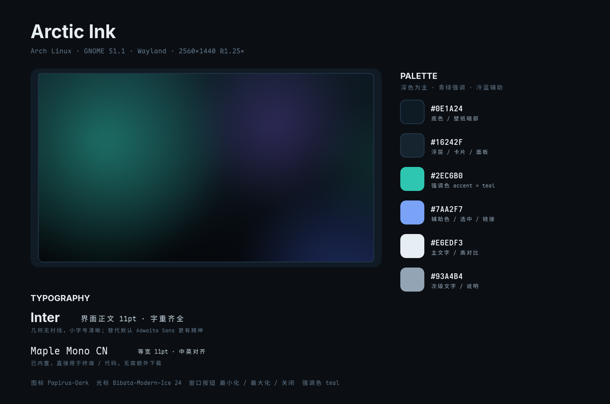

# Arctic Ink · GNOME 美化方案

> 为 **这台机器** 定制的方案：Arch Linux + GNOME Shell 51.1 + Wayland + Radeon RX 9070 XT + 27" 2K 单屏。
> 风格：冷调深色、单一青绿强调色、无衬线字体定调、轻度毛玻璃层次。



---

## 0. 交付物

| 文件 | 作用 |
| --- | --- |
| `install.sh` | 一站式安装 / 应用 / 回滚脚本（带 `--dry-run`） |
| `scripts/doctor.sh` | 只读体检，生成系统报告 |
| `scripts/make-wallpapers.sh` | 重新生成配套壁纸 |
| `scripts/make-preview.sh` | 重新生成上面这张预览卡片 |
| `preview/style-card.png` | 方案预览卡片（配色 / 壁纸 / 字体） |
| `wallpapers/arctic-ink-2560x1440.png` | 主壁纸（深色，2560×1440） |
| `wallpapers/arctic-mist-2560x1440.png` | 备用壁纸（浅色） |
| `backup/` | 安装前自动备份的 `dconf` 设置与扩展清单 |

---

## 1. 体检结论

### 1.1 系统现状

| 项目 | 现状 |
| --- | --- |
| 发行版 / 内核 | Arch Linux（rolling）/ 7.2.11-arch1-1 |
| 桌面 | GNOME Shell **51.1**，Wayland 会话，GDM 运行中 |
| 硬件 | ASUS 台式机，AMD RX 9070 XT（Navi 48，`amdgpu`），32 GiB 内存 |
| 显示 | HKC IG27Q，单屏 DP-2，**2560×1440 @59.95 Hz，缩放 1.25**（共 38 个可用模式） |
| 主题 | 全默认：`Adwaita` / `Adwaita` 图标 / `Adwaita` 光标，`/usr/share/themes` 只有 `Default`、`Emacs` |
| 扩展 | **0 个**：未安装、未启用（`disable-user-extensions=false`，列表为空） |
| 字体 | 中文字体**只有 Maple Mono CN（等宽）**；`Inter`、`Noto Sans CJK`、`JetBrains Mono` 均未安装 |
| 工具 | `yay`、`flatpak`、`gnome-tweaks 49.0`、`dconf-editor`、`imagemagick`；缺 `extension-manager`、`gnome-browser-connector` |
| 壁纸 | 系统自带 `adwaita-l/d.jxl` |

### 1.2 四个关键判断

1. **界面完全是出厂状态**——accent 仍是 `blue`，图标、光标、字体、扩展无一改动。所以"换皮肤"的空间很大，但需要先补基础件（图标主题、光标、中文字体一个都没有）。
2. **最影响观感的其实是中文字体缺失。** 系统里唯一的中文字体是等宽的 Maple Mono CN，等于中文界面全部在用"代码字体"渲染：字重单一、标点偏窄、和拉丁字母的节奏不搭。补一套中文无衬线正文（Noto Sans CJK SC，思源黑体）比换任何主题的收益都大。
3. **在 GNOME 51 + Wayland 下，"换 GTK 主题"这件事收益有限。** 绝大多数新应用是 libadwaita，它们**不吃** `gtk-theme`，只跟随 `color-scheme`（深浅色）和 `accent-color`（强调色）。所以本方案把重点放在：强调色 + 图标 + 光标 + 字体 + 壁纸 + 扩展，而 GTK 主题只用于统一旧版 GTK3 应用（`adw-gtk3`）。
4. **2K 屏只跑 59.95 Hz。** IG27Q 是高刷屏，若换 DP 线或调设置能跑更高刷新率，Dock 动效、窗口拖动的手感提升非常直接——纯软件美化给不了这种"顺滑感"。安装后建议去 设置 → 显示器 看一眼。

另外：这个版本的 mutter 已经**没有** `experimental-features`（VRR 实验开关）这个键了，不用再折腾那个 gsettings。

---

## 2. 方案设计

### 2.1 设计原则

1. **低饱和、低对比**：深底 + 一层层抬升的浮层色，靠明度区分层级，而不是靠描边和阴影堆砌。
2. **只用一个强调色**：青绿 `#2EC6B0`。GNOME 的 `accent-color` 设为 `teal`，让系统控件（开关、选中态、进度条）和壁纸属于同一种冷调。
3. **字体定调**：拉丁文用 `Inter`（几何、字重全），中文交给 `Noto Sans CJK SC`，等宽保持 `Maple Mono CN`。三者叠在一起，界面和终端是同一套语言。

### 2.2 配色

| 角色 | 色值 | 用途 |
| --- | --- | --- |
| 底色 | `#0E1A24` | 壁纸暗部、桌面主色 |
| 浮层 | `#16242F` | 面板 / 卡片 / 菜单 |
| 强调 | `#2EC6B0` | accent（青绿），与壁纸光斑同色 |
| 辅助 | `#7AA2F7` | 图表、链接、选中高亮 |
| 主文字 | `#E6EDF3` | 正文 |
| 次文字 | `#93A4B4` | 说明、占位符 |

### 2.3 四层结构

| 层 | 做什么 | 具体选择 |
| --- | --- | --- |
| 基础层 | 让系统"有质感" | `prefer-dark` + `accent-color teal`；图标 `Papirus-Dark`（文件夹配色 `teal`）；光标 `Bibata-Modern-Ice` 24；旧 GTK3 应用用 `adw-gtk3-dark` |
| 字体层 | 决定 80% 的观感 | 界面 `Inter 11`；标题栏 `Inter Bold 11`；等宽 `Maple Mono CN 11`；中文回退 `Noto Sans CJK SC` |
| 桌面层 | 结构与交互 | `Dash to Dock`（底部悬浮、智能隐藏、图标 40）；`Blur my Shell`（面板/概览毛玻璃）；`AppIndicator`（托盘）；`Just Perfection`（微调） |
| 氛围层 | 壁纸与细节 | 自绘 `arctic-ink` 壁纸（与 accent 同色系）；窗口按钮 `最小化 / 最大化 / 关闭`；24 小时制；关闭热角 |

### 2.4 组件清单

| 组件 | 版本 / 来源 | 为什么选它 |
| --- | --- | --- |
| Papirus-Dark | `papirus-icon-theme 20260801`（官方仓库） | 覆盖面最全、线条统一，暗色版对 #0E1A24 底色友好；`papirus-folders` 可单独换文件夹色 |
| Bibata-Modern-Ice | `bibata-cursor-theme 2.0.7`（AUR） | 冷色描边光标，和青绿强调色同一温度 |
| adw-gtk3-dark | `adw-gtk-theme 6.5`（AUR） | 让 GTK3 老应用（GIMP、旧版工具）和 libadwaita 新应用不再"两个世界" |
| Inter | `inter-font 4.1`（官方仓库） | GNOME 生态里最常见的第三方 UI 字体，11pt 下比 Adwaita Sans 更清晰 |
| Noto Sans CJK SC | `noto-fonts-cjk`（官方仓库，约 300 MB） | 补齐中文正文，思源黑体的骨架和 Inter 匹配度最高 |
| Maple Mono CN | 已装 | 中英等宽对齐，终端/代码直接复用，不用再装字体 |
| Blur my Shell 76 | extensions.gnome.org | 面板、概览、Dash 的毛玻璃，是"现代 GNOME"观感的主要来源 |
| Dash to Dock 110 | extensions.gnome.org | GNOME 默认没有常驻 Dock，单屏 2K 下底部悬浮 Dock 效率最高 |
| AppIndicator 66 | `gnome-shell-extension-appindicator`（官方仓库） | 微信、Steam、各种 Electron 应用的托盘图标 |
| Just Perfection 37 | extensions.gnome.org | 集中管理动画速度、隐藏元素、顶栏行为，避免装一堆小扩展 |
| Extension Manager 0.6.5 | AUR | 图形化管理扩展，比网页安装顺手（可选） |

以上扩展都已确认提供 **GNOME 51** 版本（查询自 extensions.gnome.org API）。

---

## 3. 怎么用

### 3.1 快速开始

```bash
cd gnome-theme           # 本仓库里的项目目录

./install.sh doctor      # 1. 先体检，确认现状（只读）
./install.sh all         # 2. 安装 + 应用（需要 sudo 密码）
```

### 3.2 分步执行（推荐首次这样跑）

```bash
./install.sh base            # 软件包：图标、字体、光标、GTK 主题、扩展管理器
./install.sh theme           # 壁纸、Papirus 文件夹配色
./install.sh extensions      # 安装并启用扩展
./install.sh apply           # 写入全部外观设置
```

- `apply` 可以反复执行，不会重复备份（首次的备份会一直保留，方便回滚）。
- 想先看会改什么：`./install.sh all --dry-run`。
- 不想装扩展：`./install.sh all --no-extensions`。
- 不想让脚本动系统包，只想先换外观：`./install.sh theme && ./install.sh apply`（缺包时会提示未生效）。

### 3.3 生效时机

| 内容 | 生效方式 |
| --- | --- |
| 配色、字体、图标、光标、壁纸 | 立即生效 |
| 新安装的扩展 | **注销后重新登录**（Wayland 下不能重启 Shell） |
| 扩展参数、Dock 位置 | 立即生效，或在 Extension Manager 里调 |
| `noto-fonts-cjk` 字体 | `fc-cache -f` 后新开的程序即生效 |

---

## 4. 装完后的微调

脚本写入的是"能看"的基线，真正顺眼要靠这几处：

1. **Blur my Shell**：Entry `gnome-extensions prefs blur-my-shell@aunetx` → Panel 打开 blur，`sigma` 25–35 之间；概览页模糊建议保持默认，太高会糊成一片。
2. **Dash to Dock**：`gnome-extensions prefs dash-to-dock@micxgx.gmail.com` → 位置 Bottom，自动隐藏 + 智能隐藏，图标 40–44，圆角/透明度在 Appearance 里。单屏 2K 建议**不要**开启 "extend height"。
3. **Just Perfection**：动画速度调到 `2`（稍快），关掉 "Window Picker" 和 "Search" 的额外元素；工作区切换可以设成不显示缩略图。
4. **终端配色**：GNOME Console（`kgx`）跟随系统 accent 与深浅色；字体已是 Maple Mono CN。想要更"方案感"的配色，可以把终端主题切到深色并在 Console 偏好里把背景透明度打开一点。
5. **文件夹图标配色**：脚本会自动挑一个 Papirus 支持的冷色（优先 `teal`，退而 `nordic` / `cyan` / `blue`）。想手动换：`papirus-folders -C blue --theme Papirus-Dark`，先 `papirus-folders -l` 看当前版本支持哪些。

---

## 5. 风险与回滚

| 风险 | 说明 | 处理 |
| --- | --- | --- |
| 扩展与 Shell 版本错配 | GNOME 51 较新，扩展崩溃会导致顶栏消失 | 注销后按住 `Alt` 进 TTY：`gsettings set org.gnome.shell disable-user-extensions true`，或 `./install.sh rollback` |
| AUR 主题构建慢 | `colloid-gtk-theme` 需要编译 sass，几分钟 | 只有加 `--with-shell-theme` 才会装；默认不装 |
| 包体积 | `noto-fonts-cjk` 约 300 MB | 不需要中文正文字体可以跳过该包，改用已装的 Maple Mono CN |
| 备份被覆盖 | 反复执行 `apply` | 脚本只在**首次**备份，之后不会覆盖 `backup/latest.dconf` |

回滚：

```bash
./install.sh rollback      # 卸载本次安装的扩展 + 恢复安装前的 /org/gnome 设置
```

回滚后软件包仍在系统里，需要彻底删除时按脚本输出的 `pacman -Rns` 提示操作。

---

## 6. 可选进阶

### 6.1 桌面主题（Colloid）——想要更"整套"再开

```bash
./install.sh all --with-shell-theme
```

会额外安装 `gnome-shell-extensions`（提供 User Themes）和 `colloid-gtk-theme`，把 GTK 与 Shell 主题统一成 `Colloid-Dark`。

**代价**：Shell 主题是 GNOME 美化里最容易"升级即崩"的一环。GNOME 51 刚发布不久，第三方主题的 CSS 类名未必全部对得上，可能出现顶栏高度异常、菜单错位。介意稳定性的话就用默认方案——本方案的青绿 accent + 壁纸 + 图标已经足够"不像默认"。

### 6.2 浅色模式

方案自带浅色壁纸，一条命令切换：

```bash
gsettings set org.gnome.desktop.interface color-scheme 'prefer-light'
gsettings set org.gnome.desktop.interface gtk-theme 'adw-gtk3'
gsettings set org.gnome.desktop.background picture-uri 'file://'"$HOME"'/.local/share/backgrounds/arctic-mist-2560x1440.png'
```

切回深色把 `prefer-light` → `prefer-dark`、`adw-gtk3` → `adw-gtk3-dark`、壁纸换成 `arctic-ink` 即可。

### 6.3 刷新率

当前 59.95 Hz。设置 → 显示器 里若有更高刷新率（120/144/165 Hz）建议选上；若没有，通常是线材（需要 DP 1.4）或显示器 OSD 里的 Overclock/DP 版本设置没开。

### 6.4 字体观感

脚本设的是 `font-antialiasing grayscale` + `font-hinting slight`，在 2K 27" 上最稳。想更锐利可以试 `rgba`，但 LCD 次像素渲染在深色背景上会有轻微彩边，看个人接受度。

### 6.5 还可以加的扩展

| 扩展 | 用途 |
| --- | --- |
| Clipboard History（`clipboard-history@alexsaveau.dev`） | 剪贴板历史，`Super+V` 呼出 |
| Caffeine（`caffeine@patapon.info`） | 临时禁止息屏，看视频/演示用 |
| Vitals（`Vitals@CoreCoding.com`） | 顶栏显示 CPU/内存/温度 |
| GSConnect | 手机通知与文件互传（配 KDE Connect 手机端） |

装法：`extension-manager` 里搜索安装，或 `./install.sh` 的扩展列表里加一行。

---

## 7. 验收清单

- [ ] `./install.sh doctor` 里"潜在问题"从 4 条降到 0–1 条
- [ ] 设置 → 外观：样式 = 深色，强调色 = 青绿
- [ ] 桌面壁纸是青绿/靛蓝渐变的 arctic-ink
- [ ] 文件管理器图标变成 Papirus 风格，文件夹是青绿/蓝色（脚本按 `teal → nordic → cyan → blue` 自动挑当前版本支持的配色）
- [ ] 鼠标指针变成 Bibata 冷色光标
- [ ] 中文界面不再是等宽字体（装了 Noto Sans CJK 之后）
- [ ] 底部有悬浮 Dock，顶栏和概览有毛玻璃
- [ ] 托盘区能看到常驻应用图标
- [ ] 注销重登后扩展全部正常，没有报错气泡
